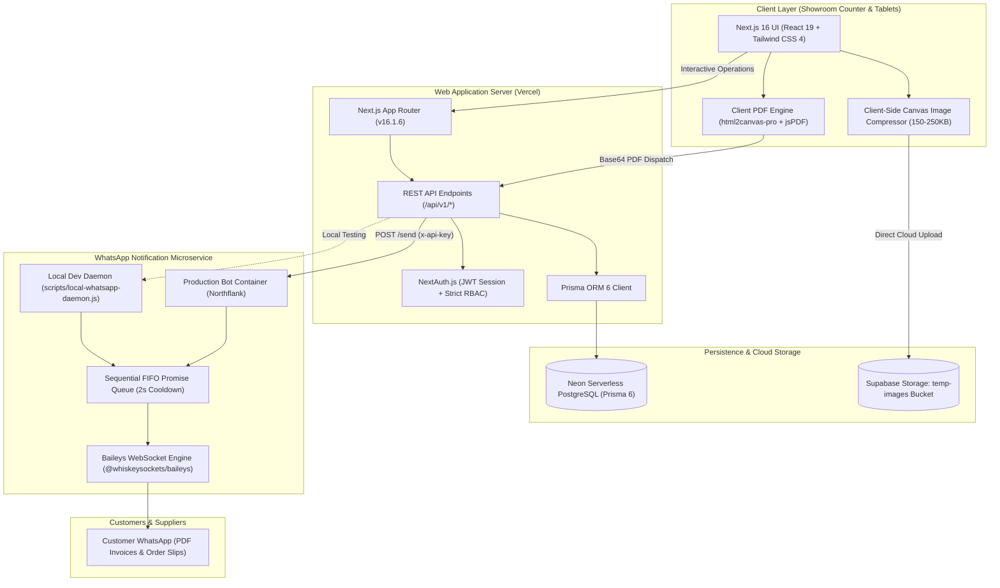

# Technology Stack & System Architecture
## Laxmi Electronics & Furnitures — Production Platform

**Version:** 2.0 (Production Release)  
**Location:** Main Market, Kanore, Udaipur (Raj.) — Helpline: +91 63755 91682  

---

## 1. Architectural Blueprint

The platform follows a modern, decoupled cloud architecture designed for high availability, zero-maintenance database scaling, instant WhatsApp media dispatch, and optimized cloud storage for mobile showroom photography.

---

## 2. Technology Selection Matrix

| Tier / Function | Primary Technology | Version | Justification & Architectural Benefit |
|---|---|---|---|
| **Web Framework** | **Next.js (App Router)** | `16.1.6` | Unified frontend & backend with React Server Components, server actions, and high-performance client routing. |
| **Frontend Library** | **React** | `19.0.0` | Latest concurrent rendering features, streamlined state management, and modern hook ergonomics. |
| **Type Safety** | **TypeScript** | `5.7.3` | End-to-end type safety spanning database models, API contracts, PDF generation, and UI state. |
| **Styling Framework** | **Tailwind CSS** | `4.0.0` | Utility-first CSS engine delivering rapid responsive UI design, modern color tokens, and optimized bundle footprints. |
| **Database Engine** | **PostgreSQL (Neon)** | `16+` | Serverless relational database with automatic branching, connection pooling, and sub-second cold starts. |
| **Object-Relational Mapper** | **Prisma ORM** | `6.4.1` | Declarative schema modeling, automated migrations, type-safe queries, and atomic multi-table transactions. |
| **Authentication & Security** | **NextAuth.js** | `4.24.11` | Secure JWT sessions, encrypted cookie storage, and credentials provider with custom RBAC claims. |
| **Cloud Object Storage** | **Supabase Storage** | `2.49.1` | Global CDN-backed S3-compatible asset storage for high-resolution customer woodworking references (`temp-images`). |
| **Image Compression** | **HTML5 Canvas API** | Native | Client-side image pre-processing compressing 5–12MB smartphone photos into crisp 150–250KB JPEGs before upload. |
| **Document Generation** | **html2canvas-pro + jsPDF** | `1.5.8` / `4.2.1` | Pixel-perfect on-device rendering of GST tax invoices, booking slips, and payment advice vouchers. |
| **WhatsApp Protocol** | **@whiskeysockets/baileys** | `6.7.19` | Direct, lightweight WebSocket implementation of the WhatsApp Web Multi-Device protocol without third-party SaaS fees. |
| **Message Queuing** | **Sequential FIFO Promise Queue** | Custom | Thread-safe in-memory task queue enforcing a 2,000ms delay between consecutive media uploads to prevent socket drops. |
| **Icons & Visuals** | **Lucide React** | `0.475.0` | Comprehensive, consistent icon library matching modern enterprise standards. |
| **Charts & Analytics** | **Recharts** | `2.15.1` | Declarative React charting library for sales trends, category contributions, and accounts receivable metrics. |

---

## 3. Specialized System Subsystems

### 3.1 Client-Side Image Compression Subsystem (`lib/image-compression.ts`)
When showroom staff upload photos of custom furniture designs directly from smartphones, the images typically exceed 8MB. Uploading raw files causes severe network lag and exhausts bandwidth.
- **Mechanism:** Draws incoming `File` objects onto an off-screen HTML5 `<canvas>`.
- **Target Constraints:** Constrains maximum dimension to 1440px while maintaining the original aspect ratio.
- **Output Quality:** Exports as JPEG at 0.78 quality, reducing payload size by 95% (typically **150KB to 250KB**) while preserving sharp woodworking and fabric details.
- **Storage Path:** Uploaded directly to Supabase Storage at `bookings/{bookingNumber}/{timestamp}_{filename}.jpg`.

### 3.2 Dual-Document WhatsApp Notification Pipeline
Advance bookings generate two distinct legal documents:
1. **Advance Package Order Slip:** Displays full package breakdown, woodworking notes, design photos, financials, and signature lines.
2. **Immediate Furniture Tax Invoice:** Official GST tax invoice (`#FURN-YYYY-NNNN`) for the furniture portion of the package.

**The Media Collision Problem & Solution:**
- *Problem:* Baileys WebSocket drops consecutive media payloads sent within milliseconds because the underlying WhatsApp Web socket cannot process overlapping upload streams.
- *Solution:* Implemented an in-memory sequential FIFO queue with an active dispatch lock and a **2,000ms cooldown window** between document uploads. The first PDF is delivered, the socket stabilizes, and the second PDF is transmitted cleanly.

### 3.3 Safe Server/Client Boundary Architecture
To guarantee that server-side API routes remain completely free from browser-only DOM dependencies:
- Pure business helpers (such as photo URL parsing) are strictly isolated in `lib/booking-photos.ts` with zero React or canvas imports.
- DOM-dependent PDF generators are isolated in `lib/pdf/booking-slip.ts` and marked explicitly with the `"use client"` directive.

---

## 4. Hosting & Deployment Topology

| Component | Target Platform | Environment & Runtime | Persistence / Volumes |
|---|---|---|---|
| **Main Web Application** | **Vercel** | Node.js Serverless Edge / Node 20 | Stateless serverless compute |
| **Primary Database** | **Neon PostgreSQL** | Cloud Serverless PostgreSQL 16 | Managed cloud storage with daily automated backups |
| **Cloud File Storage** | **Supabase Storage** | Global CDN S3 Bucket (`temp-images`) | Managed cloud object storage |
| **WhatsApp Bot (Prod)** | **Northflank** | Containerized Docker Node 20 Service | Persistent NVMe Volume mounted at `/app/whatsapp-sessions` |
| **WhatsApp Daemon (Dev)** | **Localhost** | Node.js 20+ Native HTTP (`scripts/local-whatsapp-daemon.js`) | Local file directory (`.whatsapp-sessions/`) |
