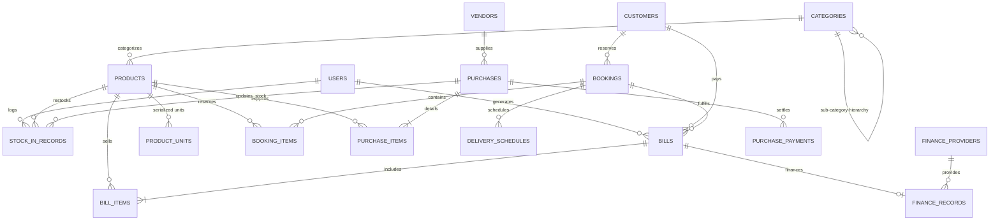

# Database Architecture Document
## Laxmi Electronics & Furnitures — PostgreSQL Schema & Entity Relationships

**Version:** 2.0 (Production Release)  
**Database:** PostgreSQL 16 (Neon Serverless)  
**ORM:** Prisma 6.4.1  

---

## 1. Entity-Relationship Diagram (ERD)

---

## 2. Table Schemas & Data Dictionary

### 2.1 Identity & Access (`users`, `password_reset_tokens`)

#### `users`
| Column | Type | Constraints | Description |
|---|---|---|---|
| `id` | `INT` | Primary Key, Auto-increment | Internal unique identifier |
| `name` | `VARCHAR` | NOT NULL | Display name of user |
| `username` | `VARCHAR` | NOT NULL, UNIQUE | Login credential |
| `email` | `VARCHAR` | UNIQUE, Nullable | Email address for alerts |
| `password_hash` | `TEXT` | NOT NULL | Bcrypt hashed credential |
| `role` | `VARCHAR` | NOT NULL | Access tier (`OWNER` or `STAFF`) |
| `is_active` | `BOOLEAN` | DEFAULT true | Account status flag |
| `created_at` | `TIMESTAMP`| DEFAULT now() | Creation timestamp |

---

### 2.2 Product Catalog & Inventory (`categories`, `products`, `product_units`, `stock_in_records`)

#### `categories`
| Column | Type | Constraints | Description |
|---|---|---|---|
| `id` | `INT` | Primary Key, Auto-increment | Unique identifier |
| `name` | `VARCHAR` | NOT NULL | Category title (e.g., Sofas, 4K TVs) |
| `department` | `VARCHAR` | DEFAULT "FURNITURE" | `"FURNITURE"` or `"ELECTRONICS"` |
| `parent_category_id` | `INT` | FK -> `categories.id`, Nullable | Hierarchical category nesting |
| `is_active` | `BOOLEAN` | DEFAULT true | Active catalog flag |

#### `products`
| Column | Type | Constraints | Description |
|---|---|---|---|
| `id` | `INT` | Primary Key, Auto-increment | Product identifier |
| `category_id` | `INT` | FK -> `categories.id` | Category reference |
| `department` | `VARCHAR` | DEFAULT "FURNITURE" | Department partition |
| `name` | `VARCHAR` | NOT NULL | Commercial product name |
| `barcode` | `VARCHAR` | UNIQUE, Nullable | UPC/EAN barcode for laser scanning |
| `brand` | `VARCHAR` | Nullable | Manufacturer / Brand (e.g. LG, Godrej) |
| `product_type` | `VARCHAR` | NOT NULL | `"SERIALIZED"` or `"QUANTITY"` |
| `cost_price` | `NUMERIC(10,2)` | NOT NULL | Showroom acquisition cost (Admin only) |
| `selling_price` | `NUMERIC(10,2)` | NOT NULL | Standard retail counter rate |
| `quantity_in_stock` | `INT` | DEFAULT 0 | Real-time physical inventory |
| `low_stock_threshold`| `INT` | DEFAULT 5 | Minimum threshold before warning alert |
| `warranty_months` | `INT` | DEFAULT 12, Nullable | Standard warranty duration |
| `image_url` | `TEXT` | Nullable | Product thumbnail image URL |
| `is_active` | `BOOLEAN` | DEFAULT true | Active sales flag |
| `created_at` | `TIMESTAMP` | DEFAULT now() | Created timestamp |
| `updated_at` | `TIMESTAMP` | Auto-update | Last modification timestamp |

#### `product_units`
Tracks individual high-value appliances by serial or IMEI number:
| Column | Type | Constraints | Description |
|---|---|---|---|
| `id` | `INT` | Primary Key, Auto-increment | Unit record ID |
| `product_id` | `INT` | FK -> `products.id` | Parent product model |
| `imei_number` | `VARCHAR` | UNIQUE, NOT NULL | Serial or IMEI number string |
| `status` | `VARCHAR` | NOT NULL | `"IN_STOCK"`, `"RESERVED"`, `"SOLD"` |
| `cost_price` | `NUMERIC(10,2)` | NOT NULL | Acquisition cost of unit |
| `added_at` | `TIMESTAMP` | DEFAULT now() | Stock receipt date |
| `sold_at` | `TIMESTAMP` | Nullable | Date finalized on a customer invoice |

---

### 2.3 Customers & Advance Wedding Bookings (`customers`, `bookings`, `booking_items`, `delivery_schedules`)

#### `customers`
| Column | Type | Constraints | Description |
|---|---|---|---|
| `id` | `INT` | Primary Key, Auto-increment | Customer unique ID |
| `name` | `VARCHAR` | Nullable | Full customer name |
| `address` | `TEXT` | Nullable | Delivery address / village location |
| `phone` | `VARCHAR` | Indexed, Nullable | Primary contact & WhatsApp phone number |

#### `bookings`
Advance packages for weddings, housewarmings, and multi-stage furniture deliveries:
| Column | Type | Constraints | Description |
|---|---|---|---|
| `id` | `INT` | Primary Key, Auto-increment | Booking ID |
| `booking_number` | `VARCHAR` | UNIQUE, NOT NULL | Human-readable ID (`ADB-2026-XXXX`) |
| `customer_id` | `INT` | FK -> `customers.id` | Customer record |
| `event_date` | `TIMESTAMP` | Nullable | Wedding / ceremony milestone date |
| `expected_delivery_date` | `TIMESTAMP` | NOT NULL | Scheduled handover date |
| `total_estimated_amount` | `NUMERIC(10,2)` | NOT NULL | Total valuation of the reserved package |
| `advance_paid` | `NUMERIC(10,2)` | DEFAULT 0 | Initial cash/UPI advance received |
| `remaining_balance` | `NUMERIC(10,2)` | DEFAULT 0 | Outstanding balance due upon delivery |
| `status` | `VARCHAR` | DEFAULT "CONFIRMED" | `"CONFIRMED"`, `"PARTIALLY_DELIVERED"`, `"COMPLETED"`, `"CANCELLED"` |
| `notes` | `TEXT` | Nullable | Order notes, fabric codes, custom dimensions |
| `created_at` | `TIMESTAMP` | DEFAULT now() | Booking date |
| `updated_at` | `TIMESTAMP` | Auto-update | Modification date |

#### `booking_items`
Line items within an advance package:
| Column | Type | Constraints | Description |
|---|---|---|---|
| `id` | `INT` | Primary Key, Auto-increment | Item ID |
| `booking_id` | `INT` | FK -> `bookings.id` (Cascade) | Associated booking |
| `product_id` | `INT` | FK -> `products.id` | Product reference |
| `department` | `VARCHAR` | NOT NULL | `"FURNITURE"` or `"ELECTRONICS"` |
| `quantity` | `INT` | NOT NULL | Quantity reserved |
| `mrp` | `NUMERIC(10,2)` | Nullable | Original MRP |
| `unit_price` | `NUMERIC(10,2)` | NOT NULL | Negotiated unit package price |
| `line_total` | `NUMERIC(10,2)` | NOT NULL | Total for line item |
| `customisations` | `TEXT` | Nullable | Wood finish, fabric code, design photo URLs |
| `is_billed` | `BOOLEAN` | DEFAULT false | True once billed on an official invoice |
| `bill_id` | `INT` | FK -> `bills.id`, Nullable | Linked tax invoice |

#### `delivery_schedules`
| Column | Type | Constraints | Description |
|---|---|---|---|
| `id` | `INT` | Primary Key, Auto-increment | Schedule ID |
| `booking_id` | `INT` | FK -> `bookings.id` (Cascade) | Associated booking |
| `scheduled_date` | `TIMESTAMP` | NOT NULL | Planned delivery window |
| `actual_delivery` | `TIMESTAMP` | Nullable | Actual dispatch timestamp |
| `status` | `VARCHAR` | DEFAULT "SCHEDULED" | `"SCHEDULED"`, `"OUT_FOR_DELIVERY"`, `"DELIVERED"` |
| `driver_notes` | `TEXT` | Nullable | Driver notes, vehicle registration |

---

### 2.4 Point of Sale, Invoicing & Finance (`bills`, `bill_items`, `finance_records`, `finance_providers`)

#### `bills`
Tax invoices generated for walk-in purchases or booking fulfillments:
| Column | Type | Constraints | Description |
|---|---|---|---|
| `id` | `INT` | Primary Key, Auto-increment | Internal bill ID |
| `bill_number` | `VARCHAR` | UNIQUE, NOT NULL | Prefix formatted (`#FURN-2026-XXXX`, `#ELEC-2026-XXXX`) |
| `bill_type` | `VARCHAR` | DEFAULT "REGULAR" | `"REGULAR"` or `"DELIVERY_INVOICE"` |
| `department` | `VARCHAR` | DEFAULT "FURNITURE" | `"FURNITURE"`, `"ELECTRONICS"`, `"COMBINED"` |
| `booking_id` | `INT` | FK -> `bookings.id`, Nullable | Linked advance booking |
| `customer_id` | `INT` | FK -> `customers.id`, Nullable | Customer record |
| `created_by_user_id`| `INT` | FK -> `users.id` | Billing counter staff |
| `delivery_date` | `TIMESTAMP` | Nullable | Physical handover date |
| `warranty_starts` | `TIMESTAMP` | Nullable | Formal warranty inception date |
| `subtotal` | `NUMERIC(10,2)` | NOT NULL | Pre-tax line item total |
| `discount` | `NUMERIC(10,2)` | DEFAULT 0 | Applied showroom discount |
| `sgst_percent` | `NUMERIC(5,2)` | DEFAULT 0 | State GST rate |
| `cgst_percent` | `NUMERIC(5,2)` | DEFAULT 0 | Central GST rate |
| `sgst_amount` | `NUMERIC(10,2)` | DEFAULT 0 | State GST calculated amount |
| `cgst_amount` | `NUMERIC(10,2)` | DEFAULT 0 | Central GST calculated amount |
| `total_amount` | `NUMERIC(10,2)` | NOT NULL | Net payable invoice amount |
| `paid_amount` | `NUMERIC(10,2)` | DEFAULT 0 | Cash/UPI received against this invoice |
| `due_amount` | `NUMERIC(10,2)` | DEFAULT 0 | Remaining credit balance |
| `payment_status` | `VARCHAR` | DEFAULT "PAID" | `"PAID"`, `"PARTIAL"`, `"UNPAID"` |
| `payment_mode` | `VARCHAR` | NOT NULL | `"CASH"`, `"UPI"`, `"CARD"`, `"EMI"`, `"DUE"` |
| `status` | `VARCHAR` | NOT NULL | `"COMPLETED"` or `"CANCELLED"` |
| `whatsapp_status` | `VARCHAR` | Nullable | `"SENT"`, `"FAILED"`, `"PENDING"` |
| `whatsapp_sent_at` | `TIMESTAMP` | Nullable | Successful dispatch timestamp |
| `is_settled` | `BOOLEAN` | DEFAULT false | Credit settlement indicator |
| `created_at` | `TIMESTAMP` | DEFAULT now() | Invoice timestamp |

---

### 2.5 Automated WhatsApp Notification Subsystem (`whatsapp_settings`, `whatsapp_deliveries`, `whatsapp_audit_logs`)

#### `whatsapp_settings`
| Column | Type | Constraints | Description |
|---|---|---|---|
| `id` | `INT` | Primary Key | Single-row configuration ID |
| `owner_phone` | `VARCHAR` | DEFAULT "8209399683" | Official showroom WhatsApp number |
| `status` | `VARCHAR` | DEFAULT "disconnected" | Connection status (`connected`, `connecting`, `disconnected`) |
| `qr_code` | `TEXT` | Nullable | Active QR code string for device pairing |
| `simulate_failures`| `BOOLEAN`| DEFAULT false | Development debugging flag |
| `simulate_session_error`| `BOOLEAN`| DEFAULT false | Development debugging flag |

#### `whatsapp_deliveries`
| Column | Type | Constraints | Description |
|---|---|---|---|
| `id` | `INT` | Primary Key, Auto-increment | Delivery log ID |
| `bill_id` | `INT` | Indexed | Associated invoice ID |
| `bill_number` | `VARCHAR` | NOT NULL | Formatted bill or booking number |
| `customer_name` | `VARCHAR` | NOT NULL | Recipient name |
| `mobile_number` | `VARCHAR` | NOT NULL | Cleaned 10-digit mobile number |
| `pdf_path` | `TEXT` | NOT NULL | Document name / storage reference |
| `custom_message` | `TEXT` | Nullable | Concise text accompanying the document |
| `status` | `VARCHAR` | DEFAULT "pending" | `"pending"`, `"sent"`, `"failed"` |
| `failure_reason` | `TEXT` | Nullable | Error message if dispatch failed |
| `sent_at` | `TIMESTAMP` | Nullable | Dispatch timestamp |

---

### 2.6 Wholesale Purchases & Vendor Ledger (`vendors`, `purchases`, `purchase_items`, `purchase_payments`)

#### `vendors`
| Column | Type | Constraints | Description |
|---|---|---|---|
| `id` | `INT` | Primary Key, Auto-increment | Vendor identifier |
| `name` | `VARCHAR` | NOT NULL | Supplier business name |
| `phone` | `VARCHAR` | Indexed, NOT NULL | Vendor telephone / WhatsApp |
| `address` | `TEXT` | Nullable | Warehouse address / city |
| `gstin` | `VARCHAR` | Nullable | Supplier GSTIN tax ID |
| `is_active` | `BOOLEAN` | DEFAULT true | Active supplier flag |

#### `purchases`
| Column | Type | Constraints | Description |
|---|---|---|---|
| `id` | `INT` | Primary Key, Auto-increment | Purchase record ID |
| `purchase_number`| `VARCHAR` | UNIQUE, NOT NULL | Formatted sequence (`PUR-2026-XXXX`) |
| `vendor_invoice_no`| `VARCHAR`| Nullable | Supplier's tax invoice number |
| `vendor_id` | `INT` | FK -> `vendors.id` | Vendor reference |
| `department` | `VARCHAR` | DEFAULT "FURNITURE" | `"FURNITURE"` or `"ELECTRONICS"` |
| `purchase_date` | `TIMESTAMP` | DEFAULT now() | Procurement date |
| `total_amount` | `NUMERIC(10,2)` | NOT NULL | Invoice payable |
| `paid_amount` | `NUMERIC(10,2)` | DEFAULT 0 | Cumulative payments disbursed |
| `due_amount` | `NUMERIC(10,2)` | DEFAULT 0 | Outstanding balance owed |
| `payment_status` | `VARCHAR` | DEFAULT "UNPAID" | `"PAID"`, `"PARTIAL"`, `"UNPAID"` |
| `is_stock_added` | `BOOLEAN` | DEFAULT true | Flag confirming stock incremented |

---

## 3. Performance & Indexing Strategy

1. **Composite Department Indexes:** `@@index([department, isActive])` on `categories` and `products` ensures rapid, index-only scans when showroom staff toggle between Furniture and Electronics catalogs.
2. **Sequential Fast Lookups:** Unique indexes on `booking_number`, `bill_number`, `purchase_number`, and `barcode` deliver `O(1)` query speed during live scanner operations.
3. **Delivery Schedule Indexing:** `@@index([scheduledDate, status])` powers the urgent deliveries widget on the owner dashboard without scanning historical bookings.
4. **Phone Indexing:** Single-column B-tree indexes on `customers.phone` and `vendors.phone` allow instant auto-fill as soon as 10 digits are typed at the billing counter.
