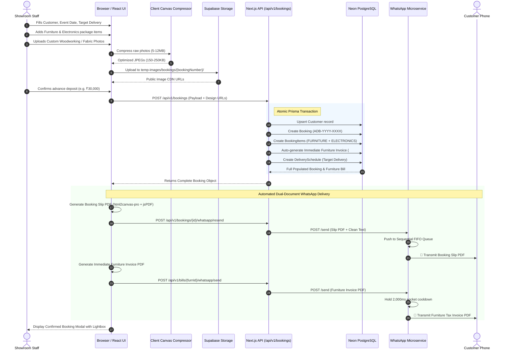
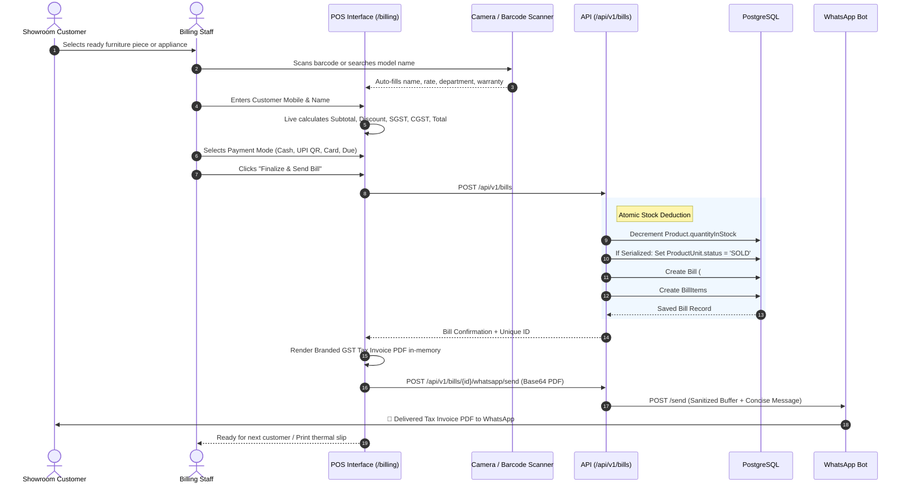
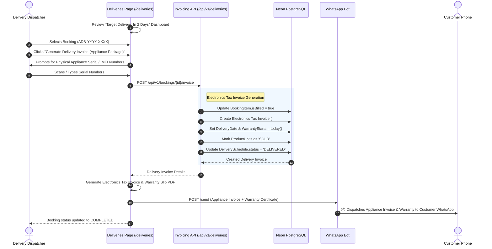
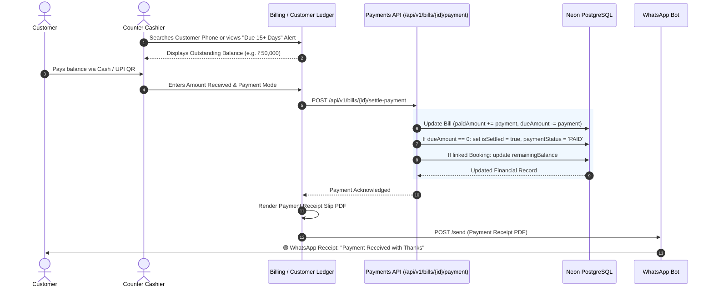
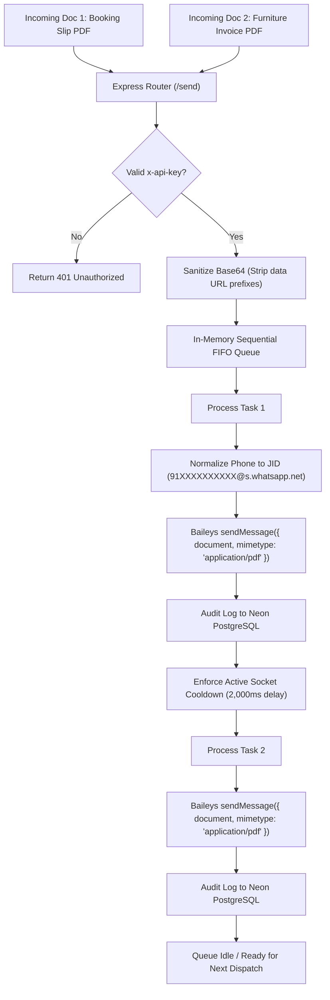

# System Data Flows & Lifecycle Workflows
## Laxmi Electronics & Furnitures — End-to-End Operational Pipelines

**Version:** 2.0 (Production Release)  
**Location:** Main Market, Kanore, Udaipur (Raj.) — Helpline: +91 63755 91682  

---

## 1. Flow 1: Advance Wedding Package Booking & Dual WhatsApp Dispatch

This is the primary workflow for wedding packages and advance furniture/electronics orders.

---

## 2. Flow 2: Walk-In Point of Sale (POS) Counter Billing

---

## 3. Flow 3: Scheduled Delivery Fulfillment & Appliance Invoicing

For advance bookings where electronics remain in `Pending Delivery` status until the event/wedding day:

---

## 4. Flow 4: Overdue Accounts Receivable & Due Payment Settlement

---

## 5. Flow 5: WhatsApp Microservice Message Queue Architecture

Handling rapid back-to-back document dispatches without socket media collisions:

